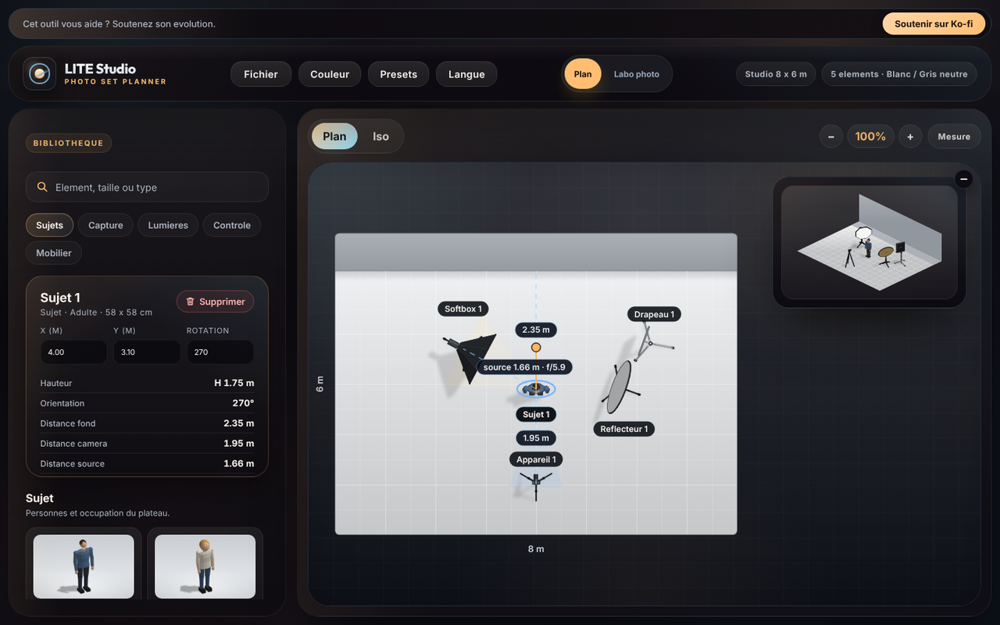
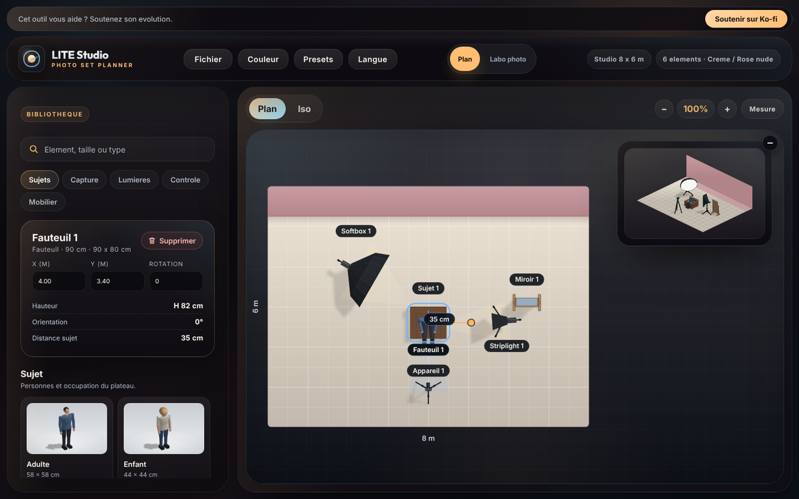
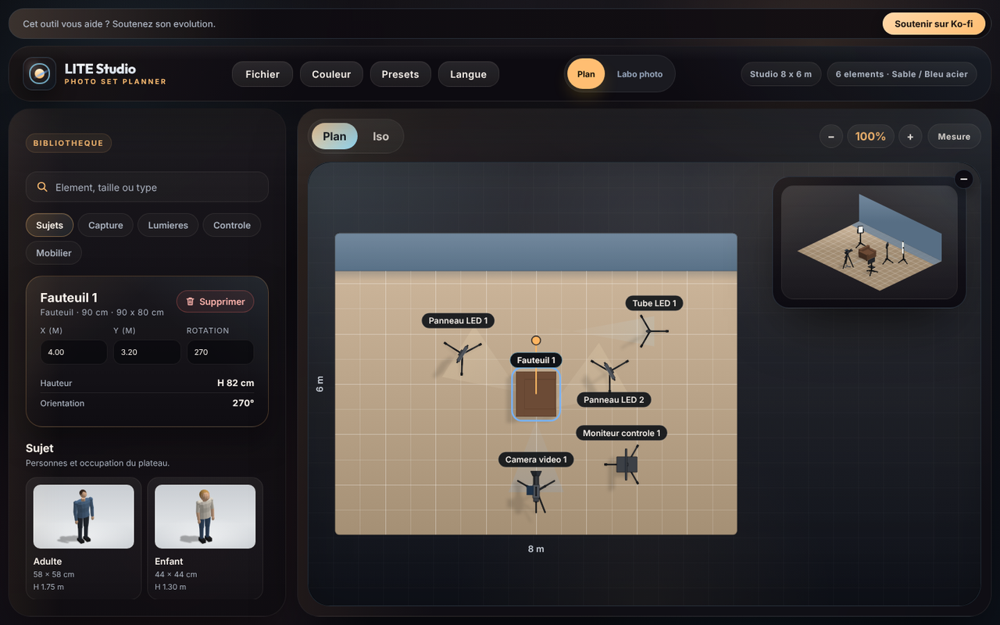

[](https://ko-fi.com/D1D21VSKW5)

Langues : [Français](README.md) · [English](README.en.md) · [Español](README.es.md) · [Deutsch](README.de.md) · [العربية](README.ar.md)

# LITE Studio

LITE Studio est une application web autonome pour preparer un plan de studio photo sur desktop et mobile.

Elle aide a construire rapidement un set, mesurer les distances utiles du plateau, zoomer dans le plan, sauvegarder des presets personnalises et exporter le schema en PNG ou PDF.

## Captures d'ecran

### Vue principale - preset portrait



### Preset boudoir



### Preset video interview



## Fonctionnalites

Direction visuelle « Lumiere de plateau » : un studio dans le noir et une seule lumiere chaude (#f2a65a), communs au site et a l'application ; titres en Bricolage Grotesque, texte en Inter (polices embarquees, OFL).

- Interface responsive utilisable sur mobile et desktop.
- Vue de dessus avec zoom, molette sur desktop, pinch-to-zoom sur mobile et apercu isometrique zoombable.
- Elements dessines en 3D a leurs vraies dimensions, identiques dans la bibliotheque, la vue plan et la vue iso.
- Labo photo : simulation de l'effet de l'ISO, de l'ouverture et de la focale sur une photo (bruit, exposition, profondeur de champ, cadrage).
- Bibliotheque d'elements avec recherche par type, taille ou famille.
- Mesures automatiques entre sujet, camera, fond et sources, plus un mode de mesure manuel.
- Reglages d'element et informations metier : hauteur, orientation, puissance source et lecture estimee a ISO 100.
- Presets integres et presets personnalises sauvegardes dans le navigateur ; galerie illustree des 46 presets sur la page Presets.
- Annuler / retablir (Ctrl+Z, Ctrl+Maj+Z) et sauvegarde automatique dans le navigateur.
- Mes plateaux : plusieurs plateaux enregistres dans le navigateur (vignette, nom, date), a rouvrir, renommer ou supprimer ; carte « Reprendre » sur la page d'accueil.
- Partage : bouton Partager (menu de partage du telephone, sinon copie du lien), lien qui contient tout le plateau, et fichier projet `.json` a enregistrer puis rouvrir (ou glisser sur le plateau).
- Feuille de plateau A4 claire : vue de dessus, vue 3D, liste du materiel et notes pour l'equipe, a imprimer ou enregistrer en PDF.
- Application installable (manifeste `manifest.webmanifest`, icones `assets/icons/`).
- Une page publique par preset (`presets/<id>.html` et ses traductions) avec vue 3D, vue de dessus, materiel et apercu de partage 1200 x 630.
- Liste du materiel generee depuis le plateau, copiable et incluse dans les exports.
- Export PNG, export PDF et impression directe du plan.
- Interface multilingue, Labo photo compris : francais, anglais, espagnol, allemand et arabe.

## Demarrage rapide

Aucune installation n'est necessaire pour le plan : ouvrez [app.html](app.html) dans un navigateur moderne, ou [index.html](index.html) pour la landing.

Le Labo photo utilise des modules JavaScript, que les navigateurs refusent de charger depuis un fichier ouvert par double-clic. Pour l'utiliser en local, lancez `npm run serve` (Node.js 18 ou plus) puis ouvrez http://127.0.0.1:4177/app.html.

1. Ouvrez l'application.
2. Ajoutez des elements depuis la bibliotheque.
3. Deplacez-les dans le plan et tournez-les avec la poignee orange.
4. Utilisez la molette sur desktop ou le pinch sur mobile pour zoomer dans la vue de dessus.
5. Activez `Mesure` pour afficher les distances autour du sujet ou tracer une mesure manuelle.
6. Utilisez le menu `Presets` pour charger un preset ou sauvegarder votre propre configuration.
7. Utilisez le menu `Fichier` pour partager un lien, enregistrer ou ouvrir un projet, afficher la liste du materiel, copier l'image, exporter en PNG ou PDF, ou imprimer le plan.

## Structure du projet

- `index.html` : landing page publique.
- `app.html` : application de plan de studio photo.
- `css/simple-studio.css` : design, responsive, mise en page et styles d'impression.
- `css/site.css` : styles de la landing et des pages editoriales.
- `js/simple-studio.js` : logique du studio, rendu canvas, presets, mesures et interactions.
- `js/studio-models.js` : modeles 3D des elements (dimensions reelles) et leur rendu en vignette, plan et iso.
- `js/photo-lab-*.mjs` et `css/photo-lab.css` : Labo photo (donnees optiques, calculs, scene, interface).
- `js/site-nav.js` : menu de navigation mobile des pages publiques.
- `scripts/generate-static-locales.mjs` : generation des pages publiques traduites (`npm run build:locales`).
- `scripts/generate-preset-gallery.mjs` : vignettes `assets/presets/*.webp`, vues de dessus `assets/presets/plan/`, apercus de partage `assets/og/presets/` et libelles + materiel `scripts/preset-gallery.json` (`npm run build:presets`, a relancer apres une modification des presets, avant `build:locales`).
- `scripts/generate-landing-shots.mjs` : scene d'accueil, apercu de partage du site et captures de l'interface de la page d'accueil (`npm run build:shots`, a relancer apres un changement visuel de l'application).
- `js/site-extras.js` : carte « Reprendre » de l'accueil et bouton Partager des pages de preset.
- `js/photo-lab-i18n.mjs` : textes du Labo photo dans les cinq langues.
- `scripts/serve-static.mjs` : petit serveur local (`npm run serve`).
- `tests/` : tests unitaires (`npm test`) et controle visuel automatique (`npm run test:visual`).
- `js/studio-locales.js` : constantes de localisation de l’application.
- `js/site-i18n.js` et `js/site-copy-*.js` : contenus et localisation des pages publiques.
- `guide.html`, `presets.html`, `faq.html` : pages d'explication et d'accompagnement.
- `schema-eclairage-portrait.html`, `plan-studio-boudoir.html`, `lighting-diagram-interview.html` : pages ciblees SEO reliees a l'application.
- `docs/screenshots/` : captures d'ecran utilisees dans le README et les apercus.

## Mise en ligne

Le dépôt contient le code et les outils ; seul le dossier `a-mettre-en-ligne/` part sur l'hébergement.

```bash
npm run build:locales   # régénère les pages traduites (si les textes ont changé)
npm run build:site      # remplit a-mettre-en-ligne/ et vérifie que chaque fichier appelé existe
```

Copier ensuite tout le contenu de `a-mettre-en-ligne/` à la racine de lumierestudio.archi-it.fr, en remplaçant l'ancien contenu.
Le dossier est régénéré à chaque fois et n'est pas versionné.

## Synchronisation avec l'appli Android

Le site est la source du catalogue (matériel, presets, objets du quotidien `obj-*`) de l'appli Android
[LITE-Studio-Android](https://github.com/rangornrar/LITE-Studio-Android). Après un changement du catalogue :

```bash
npm run build:catalog -- ../LITE-Studio-Android/shared/src/commonMain/composeResources/files/catalog
```

La version de `package.json` et le commit sont inscrits dans le catalogue ; l'appli les affiche dans « À propos ».
Les liens `#scene=z.…` et les fichiers `.json` ont le même format des deux côtés.

## Parametres d'URL utiles

Des parametres simples peuvent etre utilises pour ouvrir directement une langue ou un preset :

- `?lang=fr`
- `?lang=en`
- `?lang=es`
- `?lang=de`
- `?lang=ar`
- `?preset=portrait-soft-45`
- `?preset=boudoir-parabolic`
- `?preset=interview-led`
- `?project=<id>` : rouvre un plateau de « Mes plateaux » (utilise par la carte « Reprendre »)
- `?view=projects` : ouvre directement « Mes plateaux »

Exemple :

```text
index.html?preset=portrait-soft-45&lang=fr
```

## Soutien

Si cet outil vous est utile, vous pouvez soutenir son evolution ici :

[Ko-fi](https://ko-fi.com/D1D21VSKW5)


## Architecture et validation

Voir [les choix de découpage et les contrôles disponibles](docs/ARCHITECTURE.md).
